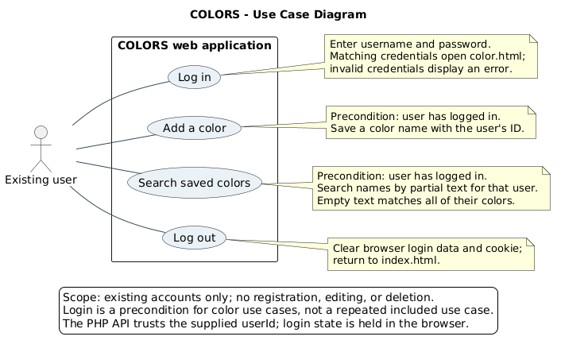
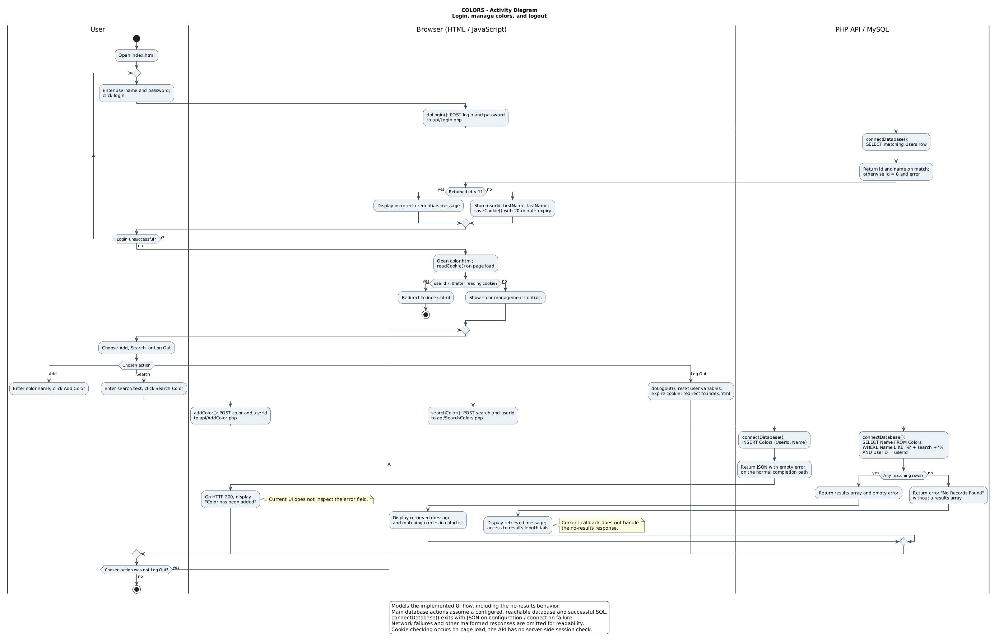
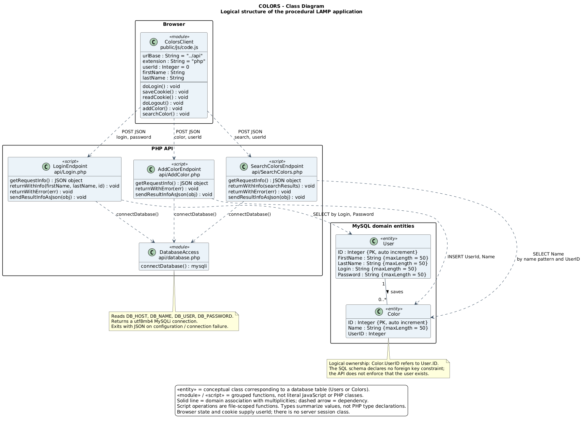

# COLORS UML diagrams

These diagrams model the COLORS lab application in this repository. Each
diagram includes editable PlantUML source, a PNG image, and an SVG image that
can be enlarged without losing clarity.

| Required diagram | Source | PNG | SVG |
| --- | --- | --- | --- |
| Use Case | [usecase.puml](usecase.puml) | [usecase.png](usecase.png) | [usecase.svg](usecase.svg) |
| Activity | [activity.puml](activity.puml) | [activity.png](activity.png) | [activity.svg](activity.svg) |
| Class | [class.puml](class.puml) | [class.png](class.png) | [class.svg](class.svg) |

## Use Case Diagram

The existing user can log in, add a color, search saved colors, and log out.
Login is a precondition for using the color management screen. It is not an
`include` relationship: the user does not repeat login for every add or search.
Account creation, editing, and deletion are outside the implemented scope.



## Activity Diagram

The swimlanes distinguish user actions, browser logic, and PHP/MySQL processing.
The flow covers unsuccessful login and retry, cookie storage and the page-load
cookie check, repeated add/search actions, and logout. The search no-match branch
shows the current callback failure because the API does not return `results`.
The add branch records that the UI displays success on HTTP 200 without checking
the JSON error. Database operations otherwise show the normal completion path;
configuration, connection, and network failures are summarized in the legend.



## Class Diagram

This is a logical class model of a procedural application. `User` and `Color`
represent the `Users` and `Colors` tables. The browser and PHP scripts are shown
as stereotyped modules/scripts grouping their actual functions; the code does
not declare these as object-oriented classes. Endpoint processing occurs at the
top level of each PHP file. Dashed dependencies show API calls, shared database
access, and database operations.

One user logically owns zero or more colors, and each color logically belongs
to one user. This describes the application domain: the supplied schema has no
foreign key, and the PHP endpoints trust the request's `userId`. The model does
not imply database-enforced ownership or a server-side authentication session.
Entity attribute lengths come from `database/schema.sql`.



## Traceability to the application

| Model element | Implementation |
| --- | --- |
| Login form and color management controls | [index.html](../../public/index.html), [color.html](../../public/color.html) |
| Login, cookies, add/search requests, logout | [code.js](../../public/js/code.js) |
| Credential lookup | [Login.php](../../api/Login.php) |
| Add a color for a supplied user ID | [AddColor.php](../../api/AddColor.php) |
| Search by name pattern and user ID | [SearchColors.php](../../api/SearchColors.php) |
| Shared environment-based database connection | [database.php](../../api/database.php) |
| User and Color attributes | [schema.sql](../../database/schema.sql) |

## Regenerating the images

With Java, PlantUML, and Graphviz installed, run from the repository root:

```sh
java -jar /path/to/plantuml.jar -charset UTF-8 -tpng "docs/uml/*.puml"
java -jar /path/to/plantuml.jar -charset UTF-8 -tsvg "docs/uml/*.puml"
```

Alternatively, render each source through the
[PlantUML server](https://plantuml.com/server). The checked-in images were
generated through that service and visually reviewed against the sources.
PlantUML documentation describes the [command-line rendering options](https://plantuml.com/command-line).

## Assignment reference materials

- [Introduction to UML slides](https://ppawar.github.io/Spring2019/CSE308-S19/Slides/PDF/Introduction%20to%20UML.pdf)
- [Pfleeger–Atlee Chapter 6 slides](https://www.cs.ucf.edu/~turgut/COURSES/Pfleeger-Atlee4EClassMaterials/PA-chapter06-Revised.ppt)

The second slide deck could not be retrieved during preparation. The diagrams
are grounded in the application files linked above. OpenAI Codex assisted with
creating the UML sources, documentation, rendered images, and Git operations.
